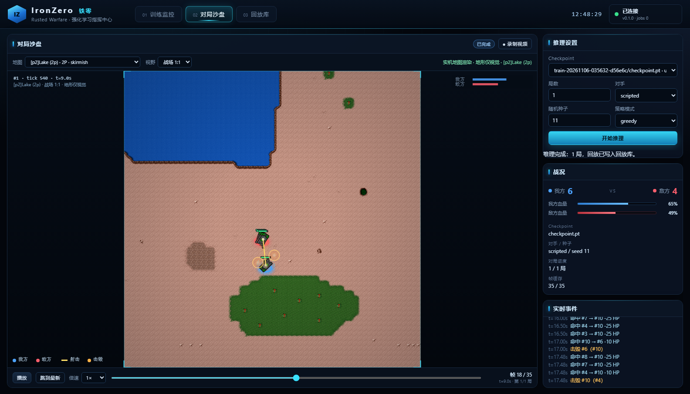

<!-- SPDX-License-Identifier: CC-BY-4.0 -->
# IronZero（铁零）

> 让 AI 在一张还在打仗的棋盘上，学会即时战略。

作者：**周培智**

**IronZero = 《铁锈战争》的 AlphaZero。** 一个面向 PC 版《铁锈战争》（Rusted Warfare）的强化学习研究项目，目标是把游戏接入为可观测、可动作、可重置、可复现的强化学习环境，并完成从训练到推理的完整闭环。

与其他 RL 框架的区别：这里真正稀缺的不是训练算法，而是**一个还在更新、有战争迷雾、按 tick 推进的商业 RTS 环境**——以及在这块活棋盘上可复现的轨迹。

> 当前状态：M1 无头环境验证已通过，本机已确认同一 1.15 Build #28 游戏资源（21.4 MiB assets、84 张地图）。
>
> 平台进度：`ironzero/1` Bridge（NDJSON/TCP）、Gymnasium 兼容环境、动作掩码、确定性微操参考环境、PPO + GAE 训练与评估闭环**已实现并通过 102 项测试**；参考环境按真实 1.15 坦克数值校准（HP 210 / 伤害 25 / 射程 130 / 75 tick 射速 / 66 单位每秒），200 轮 PPO 对脚本 AI 的评估胜率 0% → 100%（随机基线 0%，平均回报 −1.33 → +1.21）。训练/推理 Web 平台（Docker + 监控大屏 + 对局沙盘 + 回放/录制）已可运行，沙盘支持真实地图地形模拟（A* 绕水/碰撞）、迷雾与道具层。
>
> 真机进度：已从零重建 RWPP 1.15 无头运行时（180 tick 冒烟通过）；IronZero Java 扩展把真实游戏世界状态（tick/单位/队伍，10 tick 一帧）经回环 NDJSON 输出，并**支持动作注入**（move / attack_move / attack_target 经 `CommandController` 执行，回执 accepted）；`scripts/record_rwpp_replay.py` 可驱动真机单位并把回放落进平台，沙盘按真实 Lake 地图播放。**平台一键真机模式（容器内 Java + runtime）待接**，详见 [平台搭建方案 5.4](./docs/平台搭建方案.md)。

> 开源许可：代码 Apache-2.0，文档 CC BY 4.0。详见 [许可证说明](./LICENSING.md)。

## 项目目标

- 读取游戏 tick、单位、资源、建筑、生产队列和战争迷雾状态
- 为强化学习模型提供结构化观测与合法动作空间
- 支持 PPO、多环境并行、课程学习和后续自博弈
- 支持 Java Agent 原版客户端与 RWPP Headless 两种接入方式
- 支持训练完成后的独立推理与安全动作校验
- 探索 LLM 负责战略、RL 负责战术的混合架构

## 推荐架构

```text
游戏层（原版客户端 / RWPP Headless）
        ↓
游戏内 Agent（状态快照与动作队列）
        ↓
Game Bridge（TCP / ZeroMQ / Protobuf）
        ↓
Gymnasium 环境（reset / step / reward）
        ↓
训练与推理系统（PPO / 模型导出 / 安全校验）
```

## 文档

完整技术方案见：

- [铁锈战争强化学习系统架构](./铁锈战争强化学习系统架构.md)
- [训练、推理与演示架构](./训练推理与演示架构.md)
- [平台搭建方案](./docs/平台搭建方案.md)
- [文档索引](./docs/README.md)

配套规格与检查表：

- [环境规格说明](./docs/环境规格说明.md)
- [确定性与测试方案](./docs/确定性与测试方案.md)
- [安全与发布检查表](./docs/安全与发布检查表.md)
- [性能与容量基线](./docs/性能与容量基线.md)
- [协议 v1 说明](./docs/协议v1说明.md)
- [RWPP 兼容性验证](./docs/RWPP兼容性验证.md)
- [铁锈战争安装与获取](./docs/游戏安装与获取.md)
- [经典强化学习案例与 RTS 启示](./docs/经典强化学习案例与RTS启示.md)
- [RWPP 角色与适配决策](./docs/RWPP角色与适配决策.md)

## 获取游戏

PC 版通过 Steam 官方渠道获取：

- [Steam 商店页面](https://store.steampowered.com/app/647960/Rusted_Warfare/)
- [安装说明](./docs/游戏安装与获取.md)

本仓库不包含游戏本体、`assets/` 或第三方安装包。

## 展示页

- [在线展示页](https://zp-home.github.io/ironzero/)
- [IronZero Lab 静态展示页](./site/index.html)
- 页面源码与本地预览说明见 [site/README.md](./site/README.md)

本地预览：

```powershell
python -m http.server 8000 --directory site
```

## 训练与推理平台（大屏）

一条命令启动，浏览器里训练、看指标、看 agent 对打、录视频：

```powershell
docker compose -f web/docker-compose.yml up -d --build
start http://127.0.0.1:8000
```

实机地图渲染需要先把本机 1.15 客户端资源复制到本地缓存（`.game_cache/`，已 gitignore，不提交不分发）：

```powershell
.\web\scripts\prepare_assets.ps1 -GameDir "E:\path\to\Rusted Warfare1.15PC"
```

- **训练监控**：启动/停止 PPO，胜率与回报曲线、KPI、实时日志
- **对局沙盘**：载入 checkpoint 逐帧推理，canvas 渲染 8v8 坦克、血条、弹道、爆炸，支持倍速/进度条
- **实机地形**：解析 1.15 客户端 `.tmx`/tileset/坦克贴图，单位在真实陆地出生、A* 绕水行军、碰撞不穿墙；73 张地图可选，`battle` 自动跟随 / `full` 全景
- **迷雾与道具层**：视觉迷雾 + 引擎级可见性过滤；建筑/资源点（地图道具层）可单独开关
- **回放库**：每局自动落盘 `ironzero.replay/1` JSON，可重放、删除；「录制视频」导出 `.webm`
- **真机一键录制**：宿主机跑 `scripts/rwpp_real_service.py` 后，平台里点「真机录制」即可驱动真实 1.15 无头对局（IronZero 扩展 + 动作桥），录完自动进回放库并可在沙盘按真实地图播放



Dockerfile / compose / API / 目录说明见 [web/README.md](./web/README.md)。

## 开发入口

运行协议测试：

```powershell
$env:PYTHONPATH = "src"
python -m unittest discover -s tests -v
```

重新生成协议 schema：

```powershell
python tools/generate_schema.py
python tools/validate_schema.py
```

检查 RWPP 运行环境：

```powershell
.\scripts\check_environment.ps1 `
  -RuntimeDir "D:\rwpp-runtime" `
  -JavaHome "D:\jdks\jdk-25"
```

如果本机没有 Java 25，可先下载便携运行时：

```powershell
.\scripts\bootstrap_java25.ps1
```

从固定的 RWPP/RWML/game-lib 版本自动构建兼容 runtime：

```powershell
.\scripts\build_rwpp_compat.ps1 `
  -GameDir "D:\path\to\Rusted Warfare" `
  -BuildRoot "$env:LOCALAPPDATA\IronZero" `
  -ProxyUrl "http://127.0.0.1:7897"
```

脚本会完成源码下载、兼容补丁、RWML Desktop 构建、RWPP Server 构建、assets 组装和 180 tick 冒烟测试。

执行 RWPP 无头冒烟测试：

```powershell
.\scripts\smoke_rwpp.ps1 `
  -RuntimeDir "D:\rwpp-runtime" `
  -JavaHome "D:\jdks\jdk-25" `
  -Ticks 180
```

协议模型见 `src/ironzero/protocol.py`，机器可读 schema 见 `schemas/ironzero/1/messages.schema.json`。

离线参考环境与训练（不需要 JDK 25 / RWPP 运行时）：

```powershell
$env:PYTHONPATH = "src"

# 从本机游戏资源导入数值清单（已提交 configs/game_assets.json，可重复校验）
python tools/import_game_assets.py --game-dir "E:\path\to\Rusted Warfare1.15PC"

# 训练 micro-duel 策略（16 个并行环境，CPU 约 4 分钟）
python -m ironzero.training.train --updates 200 --envs 16 --rollout-steps 64 --out runs/micro_duel

# 评估 checkpoint，同时跑随机合法动作基线
python -m ironzero.training.evaluate_cli runs/micro_duel/checkpoint.pt --episodes 48

# 以 NDJSON/TCP 启动 mock 游戏侧，验证 Bridge 协议链路
python -m ironzero.mock_server --port 5123
```

设计说明、里程碑与环境准备清单见 [平台搭建方案](./docs/平台搭建方案.md)。

文档覆盖：

- 游戏接入路线对比
- Java Agent 与 RWPP Headless 架构
- 状态空间、动作空间和奖励函数设计
- 桥接协议与游戏线程安全
- PPO、多环境、课程学习和评估方案
- 推理部署与 LLM + RL 混合架构
- 分阶段实施计划和风险控制

## 计划路线

- [ ] 只读探针：读取 tick、单位、资源、建筑和迷雾（离线参考环境已实现；真机待接）
- [ ] 动作桥：移动、攻击、停止、建造、生产（前三类动作已在协议与参考环境跑通）
- [ ] Micro 场景：固定地图、小规模单位对战（离线参考环境已完成 8v8 训练与评估）
- [ ] 经济场景：采矿、建造、生产和资源点
- [ ] 完整 1v1：多地图、战争迷雾和内置 AI 基线
- [ ] 自博弈与模型评估
- [ ] LLM + RL 混合指挥

## 使用边界

本项目仅允许在单机或与公网隔离的受控内网环境中运行。禁止接入官方服务器、公共匹配和公开房间；禁止与未经同意的真人玩家进行多人对战。内网研究房间必须由项目所有者完全控制，所有参与者知情同意，并且不得暴露到公网。

第三方项目、游戏资源和反编译相关内容的使用必须遵守各自许可证与版权要求。

## 许可证

本项目采用分层开源许可证：

- 代码、脚本、测试和 schema：**Apache-2.0**
- 文档：**CC BY 4.0**
- 第三方依赖和参考项目：各自保留原许可证

详见：

- [许可证说明](./LICENSING.md)
- [Apache-2.0 全文](./LICENSE)
- [CC BY 4.0 全文](./docs/LICENSE)
- [第三方声明](./THIRD_PARTY_NOTICES.md)
- [NOTICE](./NOTICE)
- [安全政策](./SECURITY.md)

## 参考项目

- [Rusted Warfare LLM Pilot](https://github.com/Crystalhihihi/rusted-warfare-llm-pilot)
- [RWPP](https://github.com/RWPP-Team/RWPP)
- [RWPP Headless Server](https://github.com/RWPP-Team/RWPP/blob/main/rwpp-server/README.md)
- [Tape RTS mappings](https://github.com/TapeRTS/Tape)
- [Rusted Warfare 官方网站](https://rustedwarfare.com)
