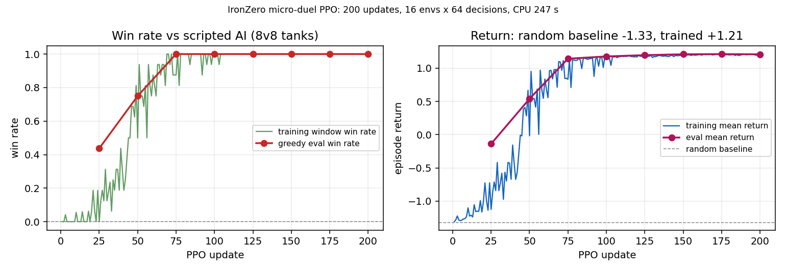
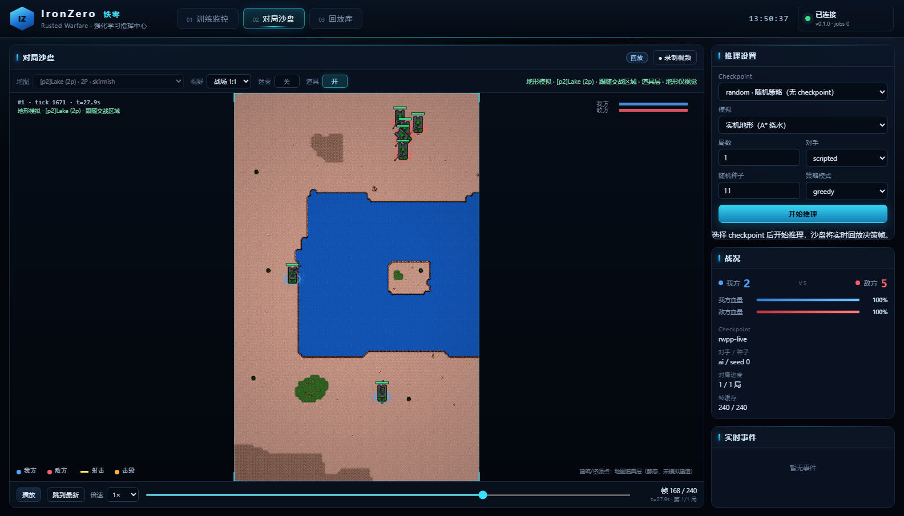
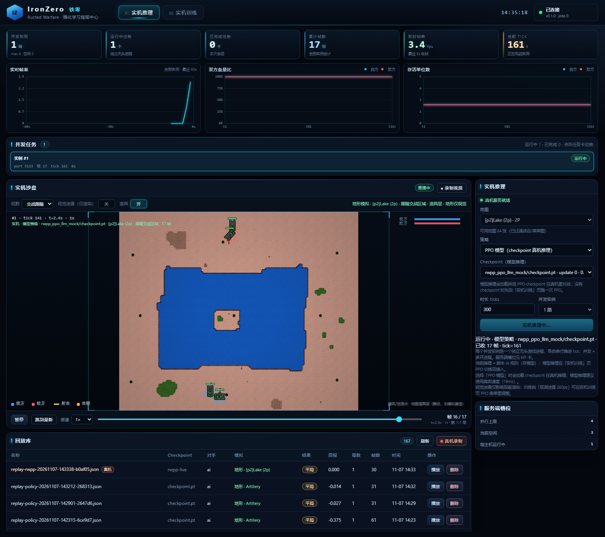
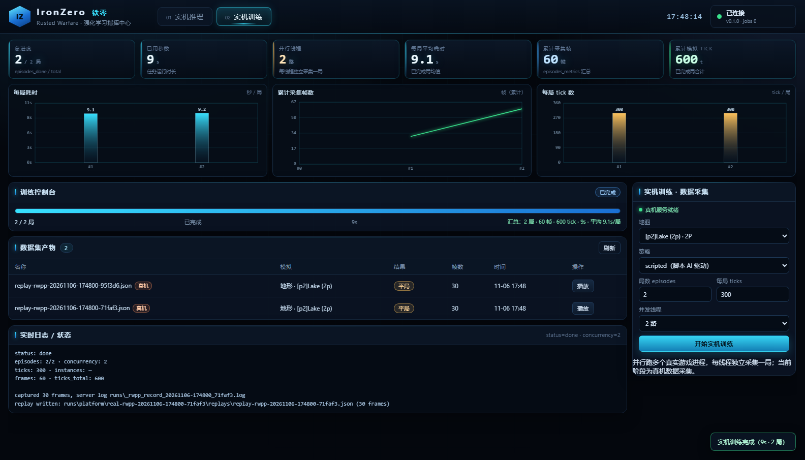
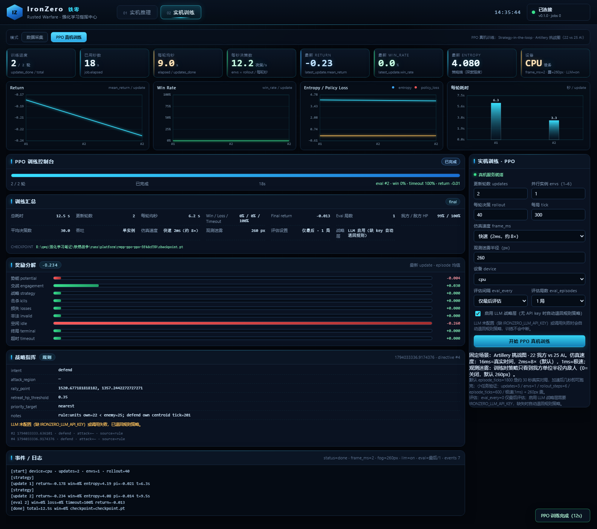

<!-- SPDX-License-Identifier: CC-BY-4.0 -->
# 平台搭建方案（M1 → M4）

> 文档状态：方案定稿 + 实施进度记录
> 作者：周培智
> 日期：2026-11-06
> 关联文档：[系统架构](../铁锈战争强化学习系统架构.md)、[训练推理与演示架构](../训练推理与演示架构.md)、[RWPP 角色与适配决策](./RWPP角色与适配决策.md)、[RWPP 兼容性验证](./RWPP兼容性验证.md)

## 0. 一句话结论

**平台方案已经定了，不是待定项；现在缺的是运行环境里的两个二进制依赖（JDK 25、RWPP/RWML 运行时），不是设计。**

已定方案（ADR，见 [RWPP 角色与适配决策](./RWPP角色与适配决策.md)）：

```text
RWPP Headless（固定 commit，Java 25）
  → IronZero Extension（游戏线程内的观测/动作扩展）
  → ironzero/1 Bridge（NDJSON over 127.0.0.1）
  → Gymnasium 兼容环境（reset/step/mask/reward）
  → PPO + GAE + 动作掩码（多环境并行）
```

同时新增一条**离线参考环境**作为并行轨道：同一套 `ironzero/1` 协议、同一套观测编码和动作掩码，但游戏侧由确定性微操引擎实现。目的是让 Bridge、环境、训练器和评估闭环在真机运行时到位之前就能跑通、能回归、能被 CI 验证。

## 1. 本机已核对的事实（2026-11-06）

| 项目 | 实测结果 | 结论 |
|---|---|---|
| 游戏本体 | `E:\qwq\强化学习笔记\Rusted Warfare1.15PC`，Version **1.15**、Game Code **176**、Build **#28** | ✅ 与 M1 兼容矩阵完全一致 |
| 游戏资源 | `assets/` 21.4 MiB / 868 个文件，84 张 `.tmx` 地图 | ✅ 可直接作为 RWPP 的 assets |
| M1 冒烟地图 | `assets/maps/skirmish/[p2]Lake (2p).tmx`，130×130 格 × 20 px = **2600×2600** 世界单位 | ✅ |
| 坦克真实数值 | HP **210**、直伤 **25**、射程 **130**、射击间隔 **75 tick**、移动 **1.1 单位/tick**（60 Hz → 66 单位/秒）、价格 **350** | ✅ 已写入 `configs/game_assets.json` |
| Java | 仅 `C:\Program Files\Java\jdk-21` | ❌ 缺 JDK 25 |
| RWPP / RWML 运行时 | 本机无 `.m2` 缓存、无构建产物 | ❌ 缺运行时 |
| 网络出口 | 回环代理 `127.0.0.1:7897` 可连，但 TLS 握手失败（curl 35 / 502） | ❌ 无法在线拉取 JDK/RWPP |

也就是说：**游戏这一半已经就位；Java/RWPP 这一半还缺，且当前网络无法自动补齐。**

## 2. 分层与模块映射

```text
┌──────────────────────────────────────────────────────────────┐
│ 平台层  web/（Docker 容器）                                   │
│   FastAPI：训练任务 / 推理推流 / 回放库 / checkpoint 列表      │
│   前端：监控大屏（训练曲线、KPI、日志） + 对局沙盘 + 录制视频   │
└───────────────────────────┬──────────────────────────────────┘
                            │ 子进程调用 CLI / JSONL 事件
┌───────────────────────────▼──────────────────────────────────┐
│ 训练/评估层  src/ironzero/training/                           │
│   policy.py（层级掩码 Actor-Critic）                          │
│   ppo.py（GAE + clip + 多环境）  evaluate.py  train.py        │
└───────────────────────────┬──────────────────────────────────┘
                            │ Gymnasium 风格 reset/step
┌───────────────────────────▼──────────────────────────────────┐
│ 环境层  src/ironzero/env.py + observations.py                 │
│   平坦观测（全局 12 + 实体 2×8×10 + 控制网格 3×8×8 = 364 维） │
│   动作掩码：kind(5)/group(5，含全体广播)/x(8)/y(8)/target(9)   │
└───────────────────────────┬──────────────────────────────────┘
                            │ 统一 adapter 接口
             ┌──────────────┴───────────────┐
             │ 进程内（训练快路径）          │ TCP（真机路径）
┌────────────▼─────────────┐   ┌───────────▼──────────────────┐
│ mock_engine.py           │   │ bridge.py                    │
│ 确定性微操引擎（校准自   │   │ tcp_adapter.py（客户端）      │
│ 真实 1.15 坦克数值）     │   │ mock_bridge.py（协议服务端）  │
└──────────────────────────┘   └───────────┬──────────────────┘
                                           │ ironzero/1 NDJSON
                                ┌──────────▼──────────────────┐
                                │ IronZero Extension（待建）    │
                                │ 游戏线程内读状态 / 执行命令   │
                                └──────────┬──────────────────┘
                                           │ RWPP API
                                ┌──────────▼──────────────────┐
                                │ RWPP Headless + 1.15 assets  │
                                └─────────────────────────────┘
```

设计要点：

1. **同一套协议**：mock 服务端和未来的 Java 扩展都只说 `ironzero/1`；Python 侧 `TcpDuelAdapter` 不需要改。
2. **同一套编码**：服务端只产出原始状态，`observations.py` 负责编码；训练和评测共用。
3. **同一套掩码**：掩码由状态推导（`build_masks`），不依赖模型输出，非法动作在环境层就被约束。
4. **进程内/进程外可切换**：训练默认走进程内引擎（快），联调和验收走 TCP（真实链路）。

## 3. 里程碑与验收

| 里程碑 | 内容 | 状态 |
|---|---|---|
| M1 | 固定版本 + 无头服务端启动 + 180 tick + 端口释放 | ✅ 本机已从零重建并复验通过（见 5.3） |
| M1.1 | 版本清单、构建脚本、资产清单 | ✅ 脚本已有；新增 `configs/game_assets.json` 资产清单 |
| M1.2 | 从游戏目录组装 runtime（assets/extensions） | ✅ `E:\IronZeroBuild\rwpp-runtime-1.15` |
| M1.3 | 长时运行 / 进程与端口清理 | 🟡 180 tick 冒烟通过；长时运行待测 |
| M2 | 只读 Bridge（tick、己方单位、资金、可见敌人、迷雾） | 🟡 真机只读状态桥已打通：真实 1.15 世界 tick/单位/队伍经 NDJSON 输出，可录制回放；资金/迷雾/动作桥待建 |
| M2.5 | 确定性 / 复现 / 回放校验 | ✅ mock 引擎逐 tick 可复现，TCP 与进程内结果逐 tick 对齐（测试覆盖） |
| M3 | 动作桥（move/attack_move/attack_target/stop/hold）与回执 | 🟡 mock 全实现；**真机动作注入已验证**（命令层 + 回执，move/attack_move/attack_target），平台一键真机模式待接 |
| M4 | Gymnasium 环境 + PPO + 评估 | ✅ 已实现并跑通训练闭环（离线参考环境） |
| M4.5 | 平台化：Docker + 监控大屏 + 对局沙盘 + 回放/视频 | ✅ `web/` 已实现，详见 [平台使用说明](../web/README.md) |

> 状态语义：✅ 已完成并有测试；🟡 代码完成但只在 mock 上验收，真机未接；⏳ 被外部依赖阻塞。

## 4. 训练方案（已定）

### 4.1 观测

```text
全局 12 维：tick 进度、双方存活数、双方 HP 占比、双方质心、相对位移
己方实体 8×10：占用位、x/y、HP、组号、当前指令、相对质心、最近敌人方向/距离
敌方实体 8×10：同上（微操场景无战争迷雾，全部可见）
控制网格 3×8×8：己方密度、敌方密度、控制差
合计 364 维 float32
```

### 4.2 动作（层级 + 掩码）

```text
[动作类型(5)] [单位组(5：4 组 + 全体广播)] [目标格 x(8)] [目标格 y(8)] [目标单位(9)]
```

- 动作类型：`move_group / attack_move / attack_target / stop / hold`
- 单位组最后一个槽位是**全体广播**：一次决策即可让全部存活单位组执行同一指令（微操的主要宏观动作）
- 选择 `move/attack_move` 时只用 x/y；选择 `attack_target` 时只用目标位；`stop/hold` 只用单位组
- 未使用头不进入对数概率（层级采样），避免无关梯度
- 掩码：死亡单位组不可选、不可见目标不可选、无目标时回退为 `stop`；广播槽位始终可用

### 4.3 奖励

```text
r_t = 0.5 × (φ_t − φ_{t−1}) + 终局奖励
φ = 己方 HP 占比 − 敌方 HP 占比           （势函数，不改变最优策略）
终局：胜利 +1.0，失败 −1.0，超时 0
```

### 4.4 算法超参

```text
PPO + GAE：gamma 0.99，lambda 0.95，clip 0.2，value_coef 0.5
entropy 0.01，lr 3e-4，minibatch 256，epochs 4
16 个并行环境 × 每环境 64 决策/轮，200 轮
MLP 364→256→256，5 个策略头 + 1 个价值头
```

### 4.5 基线与指标

保留基线：随机合法动作、脚本进攻 AI、训练后策略（贪婪/采样两种评估）。
指标：胜率、失败率、超时率、平均回报、剩余 HP 占比、平均决策数、非法动作率。

## 5. 已跑通的闭环（离线参考环境）

```powershell
$env:PYTHONPATH = "src"

# 1) 训练（约 5–10 分钟，CPU 即可）
python -m ironzero.training.train --updates 200 --envs 16 --rollout-steps 64 --out runs/micro_duel

# 2) 评估 checkpoint（同时跑随机基线）
python -m ironzero.training.evaluate_cli runs/micro_duel/checkpoint.pt --episodes 48

# 3) 走真实 TCP 链路跑一局（验证 Bridge 协议；Ctrl+C 退出）
python -m ironzero.mock_server --port 5123
```

> 具体训练曲线与胜率见 `runs/micro_duel/metrics.json`；每次运行都会生成 `checkpoint.pt`、`checkpoint_latest.pt`、`summary.json`、`eval_report.json`。

### 5.1 基线结果（2026-11-06 实测）

配置：200 轮 × 16 并行环境 × 每环境 64 决策，CPU 约 246 秒（RTX 4070 本机，训练不用 GPU 也能跑）。

| 指标 | 随机合法动作基线 | PPO（200 轮，贪婪评估） |
|---|---|---|
| 胜率 | 0% | **100%** |
| 失败率 | 100% | 0% |
| 超时率 | 0% | 0% |
| 平均回报 | −1.327 | **+1.211** |
| 己方剩余 HP 占比 | 0% | 42.1% |
| 敌方剩余 HP 占比 | 65.4% | 0% |
| 平均决策数 | 32.7 | 34.3 |

学习曲线（评估胜率）：第 25 轮 44% → 第 50 轮 75% → 第 75 轮 100% → 第 200 轮 100%。



产物（默认不提交，`runs/` 已加入 `.gitignore`）：

```text
runs/micro_duel/metrics.json        # 每轮损失/回报/胜率 + 评估历史
runs/micro_duel/summary.json        # 最终评估与随机基线
runs/micro_duel/checkpoint.pt       # 模型权重 + 配置
runs/micro_duel/train.log           # 训练日志
```

复现：

```powershell
python -m ironzero.training.train --updates 200 --envs 16 --rollout-steps 64 `
  --eval-every 25 --eval-episodes 16 --device cpu --out runs/micro_duel
python -m ironzero.training.evaluate_cli runs/micro_duel/checkpoint.pt --episodes 48
```

**边界声明**：离线参考环境校准的是真实 1.15 坦克的**数值**（HP/伤害/射程/射速/速度）和 60 Hz 时钟，但它不是游戏本体：没有寻路、地形、弹道飞行时间、护盾、迷雾。它证明的是「观测-动作-奖励-训练-评估」这条链路正确，不证明「智能体能打赢真实对局」。真实对局能力必须在 RWPP 真机环境上重新训练。

### 5.2 平台：训练 / 推理 / 监控大屏（`web/`）

平台把上面的 CLI 包成一个可观测的 Web 服务，Docker 一键启动：

```powershell
docker compose -f web/docker-compose.yml up -d --build
start http://127.0.0.1:8000
```

| 能力 | 实现 |
|---|---|
| 训练任务 | 表单启动 PPO 子进程，`events.jsonl` 增量推送逐轮指标，日志实时可见，可停止 |
| 训练监控 | 胜率/回报曲线、KPI（update、win rate、return、entropy、loss）、运行列表 |
| 推理沙盘 | 载入 checkpoint 逐帧推流，canvas 渲染 8v8 坦克、血条、弹道、爆炸，支持倍速/进度条、观战脚本模式 |
| 实机地形模拟 | 解析 1.15 `.tmx` 水面掩码：单位在地图陆地出生、A* 绕水行军、碰撞不穿墙，地图尺寸=真实像素；73 张地图可选 |
| 地形观战渲染 | 真实 tileset 地形 + 原版坦克贴图，`battle` 自动跟随交战区域 / `full` 全景视野 |
| 迷雾与道具层 | 视觉迷雾（按 260px 视野开图）+ 引擎级可见性过滤（推理可选）；建筑/资源点来自地图 Items/Units 层，可单独开关 |
| 视频记录 | 浏览器 `canvas.captureStream + MediaRecorder` 直接导出 `.webm` |
| 回放库 | 每局自动落盘 `ironzero.replay/1` JSON，可重放、删除、跨工具复用 |
| 产物持久化 | 宿主机 `runs/` 挂载进容器，checkpoint / 日志 / 回放不随容器重建丢失 |

详细用法、API 与目录说明见 [平台使用说明](../web/README.md)。

### 5.3 真机 RWPP 运行（2026-11-06 本机复验通过）

本机已从零重建固定版本的无头运行时，并用真实 1.15 资源跑通 180 tick：

| 组件 | 版本 / 结果 |
|---|---|
| JDK | Microsoft OpenJDK **25.0.5.0.2**（便携解压到 `E:\jdk25copy`） |
| RWPP | `0c8325fb4eeb98ceb0d93e279c61d05f784538f4`，Gradle 9.6.1 构建 `:rwpp-server:installDist` |
| RWML | `1.0.2` (`c5b7c8dc…`)，`publishToMavenLocal` 构建 `rwml-desktop-1.0.2.jar` |
| game-lib | `io.github.rwpp-team:game-lib:v3-1.15`，SHA-256 校验通过 |
| 游戏资源 | Rusted Warfare 1.15 / Game Code 176 / Build #28，assets 21.4 MiB |
| 运行时 | `E:\IronZeroBuild\rwpp-runtime-1.15`（bin / assets / extensions / lib） |
| 冒烟测试 | 180 tick、退出码 **0**、日志无 SEVERE、端口释放、`[rwp-server] Completed 180 frames` |

使用的兼容补丁（`scripts/build_rwpp_compat.ps1` 已内置）：

```text
game-lib v2-1.15 -> v3-1.15（RWPP 与 RWML 两份 gradle/libs.versions.toml）
LocaleEngine.b -> LocaleEngine.translateMapName
Gradle toolchain vendor JETBRAINS -> MICROSOFT
```

本机踩到的两个环境坑（已修进脚本）：

1. **PowerShell 5.1 + 原生程序 stderr**：`java -version`/`gradlew` 把版本信息写到 stderr，`$ErrorActionPreference="Stop"` 会误判为致命错误；构建/检查/冒烟脚本已改为 `Continue` 并依赖显式退出码。
2. **JDK 25 解压目录的 ACL**：从 zip 解压出的 JDK 在当前会话里 Java 进程无法创建目录（`AccessDeniedException`）；用 robocopy 复制一份到 `E:\jdk25copy` 后正常。Gradle 用户目录也固定到 ASCII 路径 `E:\IronZeroBuild\gradle-home`。

**距离「真机画面/录像」还差的一步**：写 IronZero Java Extension（`ServerExtension.runServer` 固定 tick 循环 + `SimulationBeforeTick/AfterTick` 采状态、执行动作队列 + `ironzero/1` Bridge），再把平台后端切换成 TCP 适配器；本阶段平台仍运行离线参考引擎。

### 5.4 真机 Bridge 阶段 1：只读状态流（2026-11-06 验证通过）

已完成并验证：

| 项目 | 结果 |
|---|---|
| 扩展 | `IronZeroBridge`（Java `ServerExtension`），`scripts/build_rwpp_extension.ps1` 编译打包到 `extensions/ironzero-bridge.jar` |
| 启动 | `rwpp-server.bat --no-console -- --bridge-port 5130 --ticks N --map maps/skirmish/[p2]Lake (2p).tmx` |
| 真实世界 | 载入 Lake 地图，引擎 tick 真实推进（600 tick），`units=24`、`teams=2`、`mapLoaded=true` |
| 状态流 | 回环 TCP NDJSON：`hello`（adapter 0.1.0-rwpp）→ `obs`（tick、单位 id/team/x/y/hp/max_hp，10 tick 一帧）→ `done` |
| 平台回放 | `scripts/record_rwpp_replay.py` 把真机 obs 转成 `ironzero.replay/1` 落入回放库，沙盘用 Lake 真实地图渲染（截图 `docs/assets/platform_rwpp_replay.png`） |



**阶段 2：动作注入（已验证）**

- 协议：客户端发 `step`（`move_group` / `attack_move` / `attack_target`），扩展在游戏线程上调用 `CommandController.createCommandForTeam(playerTeam)` + `addUnit()` + `setMoveWaypoint()/setAttackMoveWaypoint()/setAttackUnitWaypoint()`，然后 `dispatchQueuedCommands()` 执行
- 回执：`receipt`（accepted / executed_at_tick / accepted_count），实测 3/3 动作被接受并执行
- 效果：玩家单位真实移动（`rwpp_action_smoke.py` 实测单局位移 726px，攻击命令被接受）
- 录制：`record_rwpp_replay.py --policy scripted` 会用「攻击最近敌人」策略驱动真机单位，240 帧真机战斗回放已入回放库

尚未完成：**平台一键真机模式**——后端目前跑在 Docker（无 Java），真机录制目前由宿主机脚本驱动；下一步把「拉 runtime + 扩展 + TCP 动作循环」封装成平台服务（或给容器挂载 JDK 25 + runtime），并在前端加「真机」模拟选项。真机客户端的画面录像仍需带图形客户端 + 窗口捕获，当前提供的是真实状态级回放。

### 5.5 平台一键真机录制（2026-11-06 验证通过）

容器后端没有 Java，真机运行时留在 Windows 宿主机，通过一个小 HTTP 服务桥接：

```text
浏览器 ──POST /api/rwpp/record──▶ 容器后端(FastAPI) ──HTTP──▶ 宿主机 rwpp_real_service.py :8300
                                                                      │ 拉起 rwpp-server + IronZero 扩展
                                                                      │ 脚本策略发 step 动作
                                                                      ▼
                                                          runs/platform/real-rwpp-*/replays/*.json
浏览器 ◀── 回放库刷新（挂载卷）────────────── 沙盘播放真实 Lake 地图对局
```

- 宿主机启动：`python scripts/rwpp_real_service.py --port 8300 --max-parallel 4`
- 平台接口：`GET /api/rwpp/status`、`POST /api/rwpp/infer`（单局实机推理，帧实时回传）、`GET /api/rwpp/infer/{id}/frames`、`POST /api/rwpp/train`（多局真机数据采集，支持 `concurrency`）、`GET /api/rwpp/jobs`（最近任务列表，running 优先）、`GET /api/rwpp/jobs/{id}`
- 平台前端已收敛为两页：**实机推理**（实时沙盘 + 回放）与 **实机训练**（真机数据采集任务 + 进度 + 产物回放），两页都保留监控大屏（KPI + 曲线）
- 实测：容器内 `POST /api/rwpp/infer`（600 tick）→ 约 14 秒收完 60 帧并完成；`POST /api/rwpp/train`（1 局 × 300 tick）→ 8 秒完成并产出真机回放
- 真机地图选择（2026-11-07 修复）：`POST /api/rwpp/infer` 现在把 `map_path/map_width/map_height` 一起透传给录制器，**所选地图真正在实机生效**（此前只传了显示名，实机一直跑 Lake，前端渲染别的地图时会出现「坦克在岩浆/水面上开」的错位视觉）。实测 Artillery 挑战图 600 tick：60 帧、2778 个单位采样，其中仅 5.6% 落在浅水瓦片上——这是实机允许的涉水，不是穿模
- 地形判定口径：`blocked_mask` 只把 `Water`/`Deep Water` 视为不可通行，**浅水（Shallow Water）在 1.15 里坦克可以开过去**，因此渲染与离线地形模拟都按可通行处理
- 前端「真机录制」按钮与「真机」标签（见回放库）

**实机推理大屏**（KPI + 实时帧率 / 双方血量比 / 存活单位曲线 + 并发任务卡 + 真实地图沙盘）：



**实机训练大屏**（进度 KPI + 每局耗时柱状图 / 累计帧曲线 / 每局 tick 柱状图 + 数据集产物 + 实时日志）：



沙盘按「交战跟随」相机跟随双方单位，单位用真实坦克贴图 + 炮塔 + 阵营环 + 血条；未交战时允许左右留边以优先保证坦克可见，交战靠近后窗口收窄铺满。上方为真机回放库（标注「真机」、模拟模式与地图名）。

### 5.7 真机 PPO 训练闭环（2026-11-07 跑通）

策略网络直接在**真实 1.15 无头对局**里做决策：观测来自 IronZero bridge 的 `obs` 流，动作经 `step` 注入原生 `CommandController`，奖励由 HP 差与交战距离构成。整条链路复用既有 PPO/GAE/checkpoint 代码，只替换环境层。

```text
train_rwpp.py → RwppPPOTrainer → VecRwppEnv ─┬─ env0: rwpp-server(:5140)+bridge ─→ 真实对局
   (PPO/GAE/保存)                            └─ env1: rwpp-server(:5141)+bridge ─→ 真实对局
                                                   │ obs(tick,22v25 units) / step(actions)
                                                   ▼
                                   encode_observation(364 维) → MaskedActorCritic(168k 参数) → 5 头动作
```

- 模块：`src/ironzero/rwpp_env.py`（单实例环境：进程 + 桥 + 奖励）、`training/vec_rwpp.py`（多实例 + 自动重启 + persistent 复用）、`training/rwpp_ppo.py`、`training/evaluate_rwpp.py`（真机评估）、`training/train_rwpp.py`（CLI）
- 场景：默认 `maps/challenge/Artillery.tmx` 挑战图，**引擎预置 22 个我方单位 vs 25 个 AI 单位**，不用经济运营，开局即真实交战（`skirmish` 图是 2 辆起始坦克 vs AI 25 单位经济局，不适合微操训练）
- 观测/动作契约与离线一致：`flat_obs_dim=364`，动作头 `[kind5, group5, x8, y8, target9]`；真机桥只有位置/血量，组号/指令类型按默认值编码
- 奖励：`0.5×(HP 潜势差) + 2.0×(与敌军质心距离的接近量) + 终局 ±1`；死单位会从桥流里消失，因此按「开局军队总血量」做分母并夹到 `[0,1]`
- 单局 = 重启一个游戏进程（JVM 启动 3–5 秒）；`persistent=True` 让实例跨 PPO update 复用，仅在单局结束时重启，多个实例并行重启
- **加速（2026-11-07 加，2026-11-08 修正）**：桥扩展的 `--frame-ms` **只控制每帧墙钟预算**（16 ms = 真实时间，2 ms / 1 ms 更快），不改变仿真推进量（每帧固定 +1 tick）。一局的仿真时长由 `--ticks` / `episode_ticks` 决定（60 tick ≈ 1 秒；默认 3600 ≈ 60 秒），引擎判出胜负会提前结束。此前把 `1 ms` 宣传成“16 倍速/几秒跑完”是误导：加速只能缩短墙钟，不能把 30 秒的仗打成 60 秒
- **观测迷雾（2026-11-07 加）**：PPO 训练默认 `vision_radius=260`，策略只看到「我方任意单位 260px 内」的敌人，模拟真实战争迷雾；胜负判定/奖励仍用全量真实状态（防止「看不见敌人=赢」）。`vision_radius=0` 关闭
- **胜负上报（2026-11-08 修复）**：此前桥接/环境/录制脚本把所有结局写死或覆盖成 `timeout`，即使引擎已经判出 `Game Over! Team 1 wins!` 也不上报。现在桥接每帧轮询原生结算（`TriggerEngine` 的 `winObjective=mainBuilings` + `Team.defeated`），终局 `obs` 带 `result`/`terminated`，`done.result` 为 `victory`/`defeat`/`timeout`，环境与评估原样透传；详见 5.10
- 实测（本机 i5-14400F / RTX 4070）：
  - 900 tick 局 / 2 实例 / 16 ms（真实时间）：240 个决策 45.6 秒 ≈ 5.3 决策/秒
  - 1800 tick 局 / 2 实例 / 2 ms：240 个决策 **15.6 秒** ≈ 15.4 决策/秒（≈ 154 模拟 tick/秒，**约 3 倍**）
  - 1800 tick 局 / 4 实例 / 2 ms：480 个决策 20.2 秒 ≈ 23.8 决策/秒（多实例吞吐最好）
  - 单实例步进：16 ms ≈ 5.5、8 ms ≈ 9.3、4 ms ≈ 14.7、2 ms ≈ 20.7、1 ms ≈ 25.9 决策/秒
  - 评估可见真实交战：own_hp 0.18–0.39 / enemy_hp 1.00（随机初始策略打不过 25 单位 AI，符合预期）；引擎已判负的局现在会正确记为 `defeat`（2026-11-08 前一律被记成 `timeout`）
  - `torch 2.4.1+cu121` 可用 4070；但策略网络只有 168k 参数、单次前向微秒级，**瓶颈在 CPU 游戏进程，不在 GPU**
- 与「数据采集」模式的关系：5.5/5.6 的 `/train` 是脚本策略采集回放数据；PPO 模式是策略在环训练，产物为 `runs/<out>/checkpoint.pt` + `live.jsonl` 事件流（可直接喂给大屏）
- 平台接入（2026-11-07）：宿主机服务新增 `POST /ppo`（同一时间只允许一个 PPO 任务），训练器输出的 `live.jsonl` 通过 `GET /ppo/{id}/events?after=N` 增量读取；平台后端代理为 `POST /api/rwpp/ppo`、`GET /api/rwpp/ppo/{id}/events`、`POST /api/rwpp/ppo/{id}/stop`；「实机训练」页有「数据采集 / PPO 真机训练」模式切换，PPO 大屏显示进度、每秒决策数、return/win_rate/entropy 曲线与每轮耗时柱状图；表单可调**仿真速度（16/2/1 ms）**与**观测迷雾半径**
- 任务字段：`updates_total/done`、`envs`、`rollout_steps`、`episode_ticks`、`device`、`frame_ms`、`vision_radius`、`elapsed`、`latest_update`、`evaluations`、`summary`、`live_file`、`out_dir`

**PPO 真机训练大屏**（进度/每秒决策数 KPI + return / win_rate / entropy+policy_loss / 每轮耗时 + 事件日志 + 汇总卡，训练模式在「数据采集 / PPO 真机训练」间切换）：



### 5.9 模型推理 / 动作空间补齐 / 奖励审计 / LLM 战略层（2026-11-07）

**模型推理（PPO checkpoint 在真机里打）**
- `scripts/play_rwpp_policy.py`：加载 checkpoint → 真机环境 → 贪婪策略决策 → 帧流 JSONL + `ironzero.replay/1`（meta `source=rwpp-policy`、`checkpoint`）
- 平台：`POST /api/rwpp/infer {policy:"model", checkpoint}`（后端把 `/app/runs/...` 归一化成 `runs/...`）；推理页策略下拉可选「脚本策略 / PPO 模型 + checkpoint」
- 实测：`runs/rwpp_ppo_reward/checkpoint.pt` 在 Artillery 图 600 tick → 61 帧、4.0 秒、own_hp 0.94 / enemy_hp 0.99

**真机动作空间补齐（对齐文档 4.2）**
- Java 桥现在支持 `move_group / attack_move / attack_target / stop / hold` 五类动作
- 单位组头真正生效：按 `unit.id % 4` 映射 4 个组，动作组号 0–3 只命令对应组，组号 4（广播槽）命令全部己方单位（脚本录制与 `record_rwpp_replay.py` 已切到广播）
- `stop` = 每个单位原地停止；`hold` = 原地停止 + `AttackMode.guardArea`（守区开火）
- 实测：group=0 只移动约 1/4 单位、group=4 全体移动；hold 回执 accepted=22/22

**奖励审计（对齐文档 7.2/7.4）**
- 真机奖励改为分项累加，`info["reward_breakdown"]` 每步输出、`reward_components` 每轮聚合进 PPO live 事件与 episode 记录：
  `potential`（0.5×ΔHP 势差）、`engagement`（2.0×接近敌军）、`strategy`（0.5×接近战略目标点）、`kills`（0.25/击杀）、`losses`（−0.25/损失）、`invalid`（−0.05/被拒指令）、`idle`（−0.02/有敌情时 stop/hold）、`terminal`（±1）、`timeout`（0）
- 胜负判定用全量真实状态（迷雾下不会「看不见=赢」）；终局结果来自引擎结算（见 5.10）

**LLM 战略层（文档 12.4 / 阶段 5 骨架）**
- `src/ironzero/strategy/`：`StrategicDirective`（严格 schema 校验）、`RuleStrategy`（纯规则：劣势撤退 / 均势防御 / 优势进攻）、`LLMStrategy`（OpenAI 兼容 Chat Completions，`IRONZERO_LLM_BASE_URL/API_KEY/MODEL`，节流 3s，JSON 解析失败/网络异常/无 key 自动降级到规则层，notes 标注 `fallback:<reason>`，key 脱敏）
- 接入方式：LLM 只输出战略目标（intent / attack_region / rally_point / 优先级），**不输出单位级动作**；环境把 directive 转成 `strategy` 奖励项并写进 `kind="strategy"` 的 live 事件，PPO 战术层完全不动
- 关闭 LLM（`use_llm=false`）时完全走规则层/无战略层，RL 仍可独立训练 —— 满足「关掉 LLM 后 RL 仍能独立运行」
- 测试：`tests/test_strategy.py` 36 个用例（schema 校验、规则决策、LLM mock 成功/坏 JSON/超时/降级/节流/脱敏），全仓 148 个测试通过

**平台小修**
- 推理地图下拉只保留 `skirmish / challenge / testing`（过滤战役、菜单、生存波次图）
- 数据采集 / 推理与 PPO 训练互斥：PPO 运行时启动真机任务返回 409，反之亦然
- 评估与训练解耦：PPO 请求支持 `eval_every`（0=仅最后一轮评估，默认）与 `eval_episodes`，避免评估局拖慢每轮耗时

### 5.10 胜负判定修复：真机对局不再全是“超时/平局”（2026-11-08）

**问题**：训练 eval 永远 `win 0 / loss 0 / timeout 1.0`，推理回放永远 `result=timeout`、界面显示「平局」；把仿真速度调到 16 倍也没用。

**根因（四层叠加）**：

1. Java 桥接从不读引擎结算：`sendObservation` 写死 `terminated=false`，`sendDone` 写死 `result="timeout"`，循环只到 `--ticks` 上限就结束。实际上引擎早已判出胜负（游戏日志里能看到 `[PlayerEventMixin] Game Over! Team 1 wins!` 和 `Player was defeated`），但桥接继续推进到 tick 上限再报超时。
2. Python 环境收到 `done` 直接覆盖成 `last_result="timeout"`，且只有“敌方所有实体全灭”才算胜利；Artillery 图真正的胜利条件是 `winCondition=mainBuilings`（拆主基地/工厂），两者不一致。
3. 推理/录制脚本把 `meta.result` 硬编码为 `"timeout"`，不解析桥接的终局结果。
4. `--frame-ms` 只改墙钟节奏，不改变每局仿真 tick 数；默认 1800 tick ≈ 30 秒，22v25 的仗在 30 秒内通常分不出胜负。

**修复**：

- 桥接：每帧轮询引擎结算（`TriggerEngine` 的 win/lose 目标 → `victoryScreenShown`/`defeatScreenShown`，以及 `Team.defeated`/`wipedOut` → 队伍被消灭），判定后发一帧 `obs`（`result` + `terminated=true`）并立即发 `done` 后退出；`done.result` 为 `victory|defeat|timeout`。顺带把实体建筑标记（`is_building/is_factory/is_builder/is_operational`）补进 obs，`entity_type_id` 2=建筑。
- 环境：`RwppDuelEnv` 尊重 `obs`/`done` 的 `result`；终局奖励按 `victory +win_reward` / `defeat +loss_reward`；tick 上限和连接断开才算 `timeout`。连接 EOF 立即失败返回（不再空转 60 秒），`step` 不再因 `ConnectionReset` 抛异常打断整个训练。
- 训练：默认 `episode_ticks=3600`（60 秒仿真）；每轮 live 事件与日志新增 `loss_rate`/`timeout_rate`（`[train] ... win/loss/timeout`）。
- 推理/录制/平台：`record_rwpp_replay.py`、`play_rwpp_policy.py` 从终局 obs/done 写真实 `result`（含 `terminated`/`truncated`）；宿主机服务把每局 `result` 放进 job 状态与 `episodes_metrics`；前端 `timeout` 显示为「超时」（`draw/tie` 才是平局），推理/训练汇总显示胜负计数，默认每局 3600 tick，并明确 `frame_ms` 只影响墙钟速度。

**验证（本机 2026-11-08）**：

- 脚本策略在 Artillery 图：5 次对局分别在 tick 1894/1982/2169/2620/2752 判负，回放 `meta.result="defeat"`、`terminated=true`、`truncated=false`，终局帧 `result="defeat"`；桥接日志 `[ironzero] game over: defeat tick=...`
- 空闲策略 300 tick：`result=timeout`（诚实超时），不会误判。
- 环境端到端（真实游戏）：`RwppDuelEnv` 返回 `terminated=True, result="defeat"`；随机策略 3600 tick 仍为 `timeout`（策略不交战，属于正常平局式结果）。
- 旧数据注意：2026-11-08 之前的 `runs/platform/**/live.jsonl`、`metrics.json`、回放里的 `timeout` 是旧代码写死的/覆盖的，不可作为胜负统计依据。

**读结果的方法**：训练看 `[eval] win/loss/timeout`、`metrics.json.final_eval`、每轮 `live.jsonl` 的 `update.loss_rate/timeout_rate`；推理看回放 `meta.result` 与平台回放库「结果」列；`timeout` 表示到 tick 上限仍未分胜负（可以调大「每局 tick」或换更接近的小场景）。

### 5.8 并发与线程（2026-11-06 验证通过）

真机一侧的「线程」不是游戏内多线程：**每个并发实例 = 一个独立的 RWPP 无头游戏进程 + 独立 bridge 端口**，游戏模拟本身仍单线程串行推进 tick。所以在平台上调「并发」等于多开进程，靠端口池隔离。

```text
宿主机 rwpp_real_service.py --max-parallel 4
  ├─ 端口池 5130..5133（queue，抢占/归还）
  ├─ POST /infer  ×N  → N 个独立 recorder 进程并发跑各自对局，各自 frames.jsonl
  └─ POST /train {episodes, concurrency} → 线程池取端口，逐局领任务，episodes_metrics 按完成顺序追加
```

- 参数：宿主机 `--max-parallel`（默认 4，即同时最多 4 个游戏进程）；训练 payload `concurrency`（1..max_parallel，默认 2）；推理并发由前端 fan-out 多个 `/api/rwpp/infer`（每个占 1 个槽位）
- 槽位耗尽时宿主机返回 **409**（`all parallel slots are busy`），平台后端原样透传 409，前端应提示并保留已成功任务
- 任务字段：`elapsed` 实时递增、`started_ts`、`frames`（累计帧）、`ticks_total`、`episodes_metrics[i] = {episode, seconds, ticks, frames, replay}`
- 唯一性：每次录制的运行目录/回放/日志都带 `uuid` 后缀，因此同秒并发不会互相覆盖（此前并发 1/2 失败即因时间戳目录撞车，已修）
- 实测（本机 Windows，`--max-parallel 4`）：
  - 2 路并发 `/infer`（300 tick）：端口 5130 / 5131，各自 30 帧，均 `done`，无冲突
  - `/train` episodes=2、concurrency=2、240 tick：两局并行，各自 8.3 秒、24 帧，回放路径互不相同
  - 对比单路：单局 300 tick 约 8–9 秒，所以并发主要在「批量采集吞吐」，单局延迟不会变快


## 6. 环境准备清单（需要人工完成）

### 6.1 JDK 25

```text
任选其一：
- Microsoft OpenJDK 25（与已验证兼容矩阵一致）
- JetBrains Runtime 25（RWPP 默认工具链）
安装到纯英文路径，例如 D:\jdks\jdk-25，设置 JAVA_HOME。
```

### 6.2 RWPP / RWML

```text
固定版本（见 vendor/rwpp/pinned-versions.json）：
- RWPP:   0c8325fb4eeb98ceb0d93e279c61d05f784538f4
- RWML:   1.0.2 (c5b7c8dc57da25d667f1536a7badb6d3e21182b6)
- game-lib: io.github.rwpp-team:game-lib:v3-1.15
构建：scripts/build_rwpp_compat.ps1（需要网络与 Gradle，代理显式传给 Java/Gradle）
```

### 6.3 一键组装（运行时到位后）

```powershell
.\scripts\build_rwpp_compat.ps1 `
  -GameDir "E:\qwq\强化学习笔记\Rusted Warfare1.15PC" `
  -BuildRoot "$env:LOCALAPPDATA\IronZero" `
  -ProxyUrl "http://127.0.0.1:7897"

.\scripts\smoke_rwpp.ps1 `
  -RuntimeDir "$env:LOCALAPPDATA\IronZero\rwpp-runtime" `
  -JavaHome "D:\jdks\jdk-25" `
  -Ticks 180
```

### 6.4 网络

当前 `127.0.0.1:7897` 代理 TLS 失败，Gradle/Maven 无法拉依赖。需要修复代理，或手工提供：
`rwml-desktop-1.0.2.jar`、`game-lib:v3-1.15`（本地 Maven 布局）、RWPP 源码/构建产物。

## 7. 真机接入顺序（运行时到位后）

1. **M1 复核**：`check_environment.ps1` + `smoke_rwpp.ps1`，确认 180 tick、退出码 0、端口释放。
2. **M2 只读扩展**：在 `ServerExtension.runServer` 固定 tick 循环里，`SimulationAfterTick` 采集快照（tick/己方单位/资金/可见敌人/局部地图/掩码），经 NDJSON 推送。
3. **对齐校验**：用同一局种子对比 mock 与真机的观测编码维度、掩码语义、目标槽位顺序；不一致先修编码，不急着训练。
4. **M3 动作桥**：`SimulationBeforeTick` 取命令队列执行；回执带 `accepted/rejected_reason/executed_at_tick`；旧 tick、重复 `decision_id` 必须拒绝。
5. **M4 训练迁移**：把 `MicroDuelAdapter` 换成 `TcpDuelAdapter`，先在脚本 AI 上跑通 100 局不崩溃，再开始 PPO；真机采样慢，先小规模（4–8 实例）验证曲线。
6. **课程推进**：micro 8v8 → 加生产/建造 → 加迷雾 → 完整 1v1 → 自博弈。

## 8. 主要风险与对策

| 风险 | 对策 |
|---|---|
| JDK 25 / RWPP 产物缺失 | 本机离线开发不阻塞：mock 轨道继续推进；运行时到位后按第 7 节顺序接 |
| 网络不可达 | 手工提供 Maven 本地仓库；或先在可联网机器构建 runtime 后整体拷回 |
| 反射/混淆随版本失效 | 版本锁定 + 启动自检 + 能力探测；升级后重跑 M1 冒烟与只读探针 |
| 真机采样慢 | 进程内多实例 + 动作重复（2 Hz 决策）+ 优先 micro 场景 |
| 观测/掩码语义漂移 | mock 与真机共用 `observations.py`；加契约测试（维度/顺序/掩码） |
| 许可证 | RWPP AGPL-3.0、RWML 非 OSI；本项目代码 Apache-2.0，不复制上游源码，补丁独立记录 |

## 9. 下一步（按优先级）

1. 运行环境修复后，M1 复核 + M2 只读扩展（Java 侧骨架）。
2. 在真机上跑通 `TcpDuelAdapter` 的 100 局 reset/step 稳定性。
3. 真机数据带回离线做观测编码对比测试，锁定 schema v1。
4. 真机 micro 场景 PPO 小规模训练，与离线基线对比。
