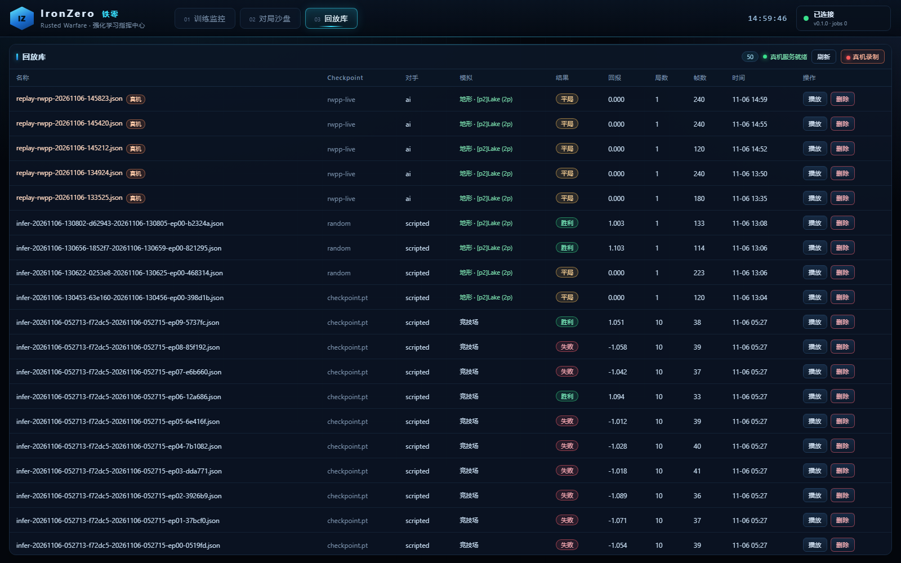
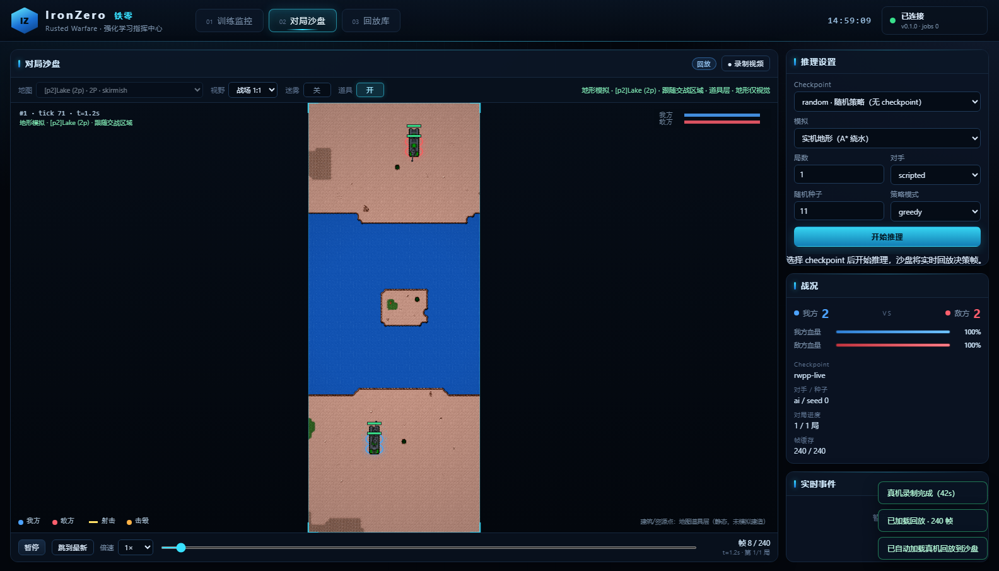
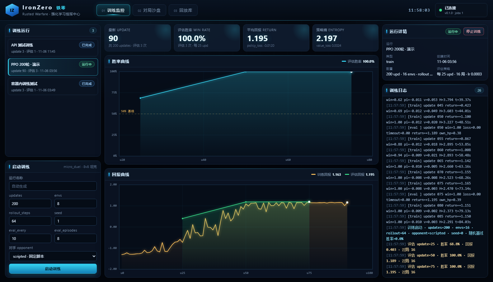
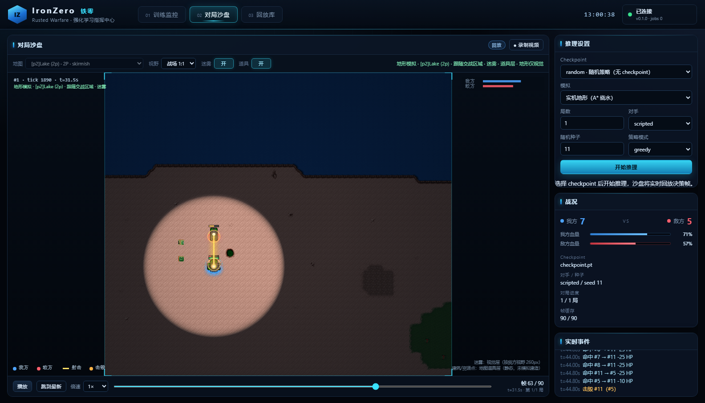
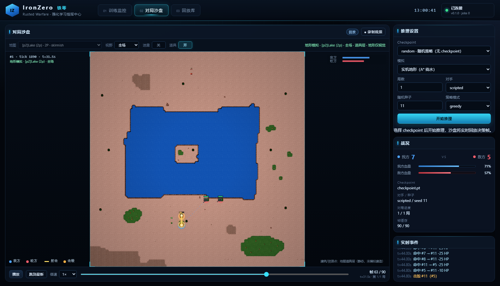
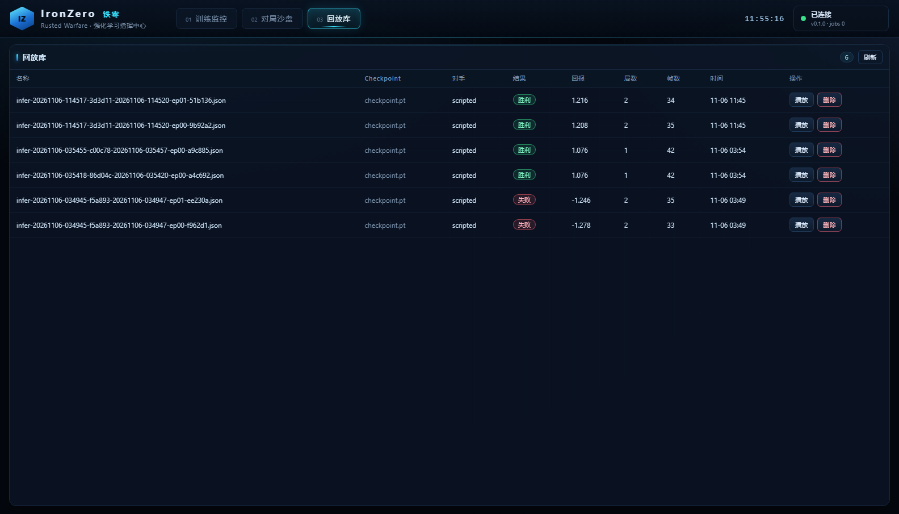

# IronZero 平台（训练 / 推理 / 监控大屏）

> 作者：周培智
> 状态：可运行（Docker + 本机开发两种方式）
> 依赖：Docker Desktop（推荐）或本机 Python 3.11+ / Torch

一个面向《铁锈战争》强化学习项目的本地平台，用来**启动训练、实时看指标、跑推理、看 agent 对打、录制回放**。

```text
┌──────────────────────────── 浏览器 ────────────────────────────┐
│ 训练监控（曲线/KPI/日志）  │  对局沙盘（实时帧）  │  回放库      │
└──────────────────────────────┬─────────────────────────────────┘
                               │ HTTP / JSON
┌──────────────────────────────▼─────────────────────────────────┐
│ FastAPI 平台后端  web/backend/app.py                           │
│  /api/runs      训练任务（子进程 + events.jsonl + 日志）        │
│  /api/infer     推理任务（逐帧推流 frames.jsonl）               │
│  /api/replays   回放库（JSON 帧序列）                           │
│  /api/checkpoints 模型列表                                     │
└──────────────────────────────┬─────────────────────────────────┘
                               │
┌──────────────────────────────▼─────────────────────────────────┐
│ ironzero 训练 / 推理库（src/ironzero）                          │
│  PPO + 动作掩码 + 确定性微操环境（真实 1.15 坦克数值校准）       │
└────────────────────────────────────────────────────────────────┘
```

## 1. 启动（Docker，推荐）

```powershell
# 首次构建（需要网络；通过 host.docker.internal 走本机代理）
docker compose -f web/docker-compose.yml up -d --build

# 打开大屏
start http://127.0.0.1:8000
```

- 宿主机 `runs/` 挂载进容器 `/app/runs`，模型、日志、回放都持久化在宿主机。
- 宿主机 `web/frontend/` 以只读方式挂载进容器，改前端刷新浏览器即可，不必重建镜像（后端改动需重建）。
- 停止：`docker compose -f web/docker-compose.yml down`
- 查看日志：`docker logs -f ironzero-platform`
- 只重建镜像：`docker compose -f web/docker-compose.yml up -d --build`

如果构建时拉依赖失败，确认 Docker Desktop 能访问代理；也可以在 `web/docker-compose.yml` 里修改 `HTTPS_PROXY` 构建参数。

## 2. 启动（本机开发，不装 Docker）

```powershell
$env:PYTHONPATH = "src"
python -m uvicorn web.backend.app:app --host 127.0.0.1 --port 8000 --reload
```

前端是纯静态文件（`web/frontend`），由同一个服务在 `/` 与 `/static/*` 提供，改完刷新即可。
静态预览（不启动后端时）：`python -m http.server 8011 --directory web/frontend`。

## 3. 页面功能

### 训练监控

- 表单启动 PPO：`updates / envs / rollout_steps / opponent / seed / eval_every / eval_episodes / lr / entropy`
- KPI：最新 update、训练窗口胜率、平均回报、entropy、策略/价值损失
- 曲线：评估胜率、平均回报（含随机基线参考线）
- 日志：训练子进程 stdout 尾巴，失败原因直接可见
- 停止：终止训练子进程（已产出的 checkpoint 保留）

训练任务目录（宿主机 `runs/platform/train-*`）：

```text
meta.json       任务元数据与状态
events.jsonl    逐 update / eval / done 事件（前端增量拉取）
stdout.log      训练日志
metrics.json    训练结束后的完整指标
checkpoint.pt   模型权重
```

### 对局沙盘（人工观测 agent 对打）

- 选择 checkpoint / 局数 / 对手 / 种子 / 策略模式（greedy / sample / random / **scripted 观战**）
- **两种模拟模式**：
  - `微操竞技场（arena）`：训练用的 1000×1000 确定性微操，抽象/地图皮肤渲染
  - `实机地形（terrain）`：读取真实 `.tmx` 水面掩码，单位在陆地出生、A* 绕水行军、碰撞不穿墙；地图尺寸即真实像素尺寸
- **地图选择**：73 张可用地图（按 skirmish/normal/survival 排序），`battle` 视野自动跟随交战区域（1:1 像素）、`full` 全场视野
- **迷雾开关**：视觉层按我方单位 `vision_radius` 开视野；引擎级迷雾（推理时过滤不可见敌人、目标不可选）可通过推理参数 `fog` 开启
- **道具层开关**：建筑/资源点来自地图 Items/Units 层（静态），可单独显示/隐藏
- 单位使用原版坦克贴图（车体 + 炮塔 + 阵营环 + 血条），shot 弹道/枪口闪光、kill 爆炸
- 支持播放 / 暂停 / 0.5–4 倍速 / 进度条 / 跳到最新；「录制视频」导出 `.webm`
- 每局自动写入回放库；回放记住 `sim_mode`、地图、迷雾视觉设置

### 回放库

- 列出所有录制回放（对手、结果、回报、帧数、时间）
- 点击载入沙盘重放；支持删除
- 回放是纯 JSON（`ironzero.replay/1`），可以直接用别的工具消费

### 真机一键录制（真实 Rusted Warfare 1.15）

平台容器里没有 Java，真实游戏运行时在宿主机上，通过一个小 HTTP 服务桥接。启动一次（保持运行）：

```powershell
python scripts\rwpp_real_service.py --port 8300
```

然后在平台「回放库」点「● 真机录制」：宿主机拉起 `rwpp-server` + IronZero 扩展，脚本策略通过动作桥驱动真实单位，跑完把回放写进 `runs/platform/real-rwpp-*/replays/`，平台自动刷新并可在沙盘按真实 Lake 地图播放（回放行标注「真机」）。





> 真机服务只监听本机/内网，不暴露公网。真实游戏画面录像需要带图形客户端 + 窗口捕获，这里提供的是真实状态级回放。

## 4. 准备游戏资源（实机地图渲染）

沙盘的地形与坦克贴图来自本机 1.15 客户端资源，需要先复制一份到本地缓存（`.game_cache/`，已 gitignore，**不会提交、不会分发**）：

```powershell
.\web\scripts\prepare_assets.ps1 -GameDir "E:\qwq\强化学习笔记\Rusted Warfare1.15PC"
```

脚本会复制 `assets/tilesets`（图集）、`assets/maps`（84 张 .tmx）与坦克贴图，约 5 MB。Docker 启动时以只读方式挂载 `.game_cache` 到 `/app/game_cache`；没有缓存时平台照常运行，沙盘自动回退抽象圆点渲染。

## 5. API 速查
| 方法 | 路径 | 说明 |
|---|---|---|
| GET | `/api/health` | 健康检查 |
| GET/POST | `/api/runs` | 列表 / 启动训练 |
| GET | `/api/runs/{id}` | 状态、最新指标、日志尾巴 |
| GET | `/api/runs/{id}/events?after=N` | 增量训练事件 |
| POST | `/api/runs/{id}/stop` | 停止训练 |
| GET | `/api/checkpoints` | 可用模型 |
| POST | `/api/infer` | 启动推理（逐帧推流，可带 `map_id`） |
| GET | `/api/infer/{id}` | 推理状态 |
| GET | `/api/infer/{id}/frames?after=N` | 增量帧 |
| GET | `/api/replays` | 回放列表 |
| GET/DELETE | `/api/replays/{id}` | 读取 / 删除回放 |
| GET | `/api/maps` | 可用地图列表 + 单位贴图清单 |
| GET | `/api/maps/{id}` | 地图详情（图层 gid、tileset 图集、战场窗口） |
| GET | `/api/assets/{path}` | 游戏图集/贴图文件（只读，路径校验） |
| GET | `/api/rwpp/status` | 宿主机真机服务健康状态 |
| POST | `/api/rwpp/record` | 一键录制真实对局 `{ticks, policy}` |
| GET | `/api/rwpp/jobs/{id}` | 真机录制任务状态 |

## 6. 目录

```text
web/
  backend/app.py        FastAPI 服务（任务、事件、回放）
  backend/maps.py       Rusted Warfare 地图/图集解析（.tmx、gid、战场窗口）
  frontend/             纯静态大屏（index.html / app.js / style.css）
  Dockerfile            平台镜像（python:3.12-slim + CPU torch）
  docker-compose.yml    一键启动（runs/、frontend/、.game_cache/ 挂载）
  scripts/              开发/运维小脚本（含 prepare_assets.ps1）
src/ironzero/           训练、环境、回放、协议（被平台调用）
runs/                   产物（已 gitignore）
.game_cache/            本机游戏资源缓存（已 gitignore，不提交）
```

## 7. 界面










## 8. 边界

- 平台当前跑的是**离线参考环境**（按真实 1.15 坦克数值校准的 8v8 微操），不是游戏本体；真机 RWPP 接入后只需把后端里的训练/推理命令换成 TCP 适配器版本。
- 平台默认只在本机/内网使用，不要暴露到公网。
