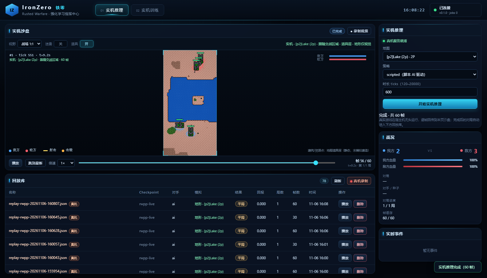
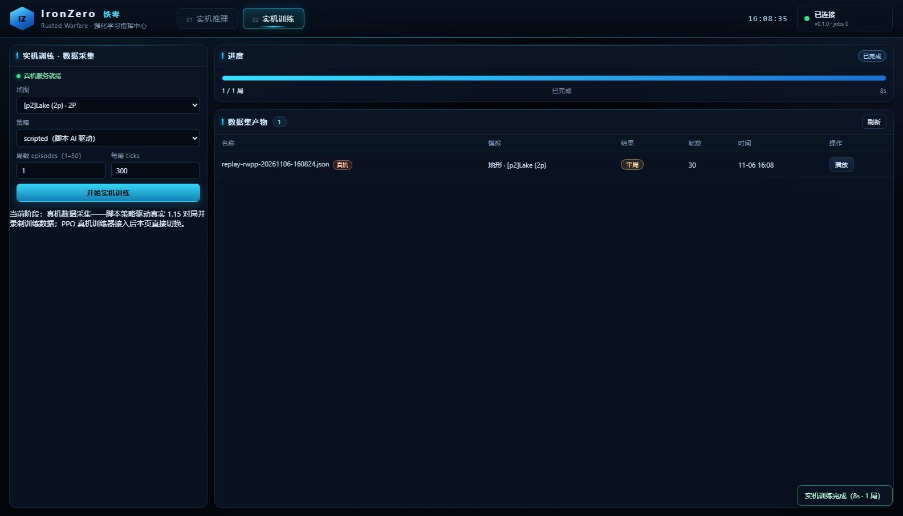
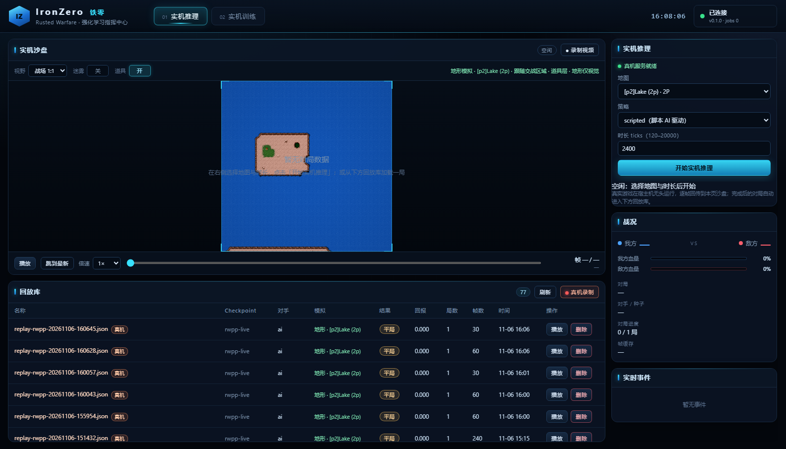

# IronZero 平台（训练 / 推理 / 监控大屏）

> 作者：周培智
> 状态：可运行（Docker + 本机开发两种方式）
> 依赖：Docker Desktop（推荐）或本机 Python 3.11+ / Torch

一个面向《铁锈战争》强化学习项目的本地平台，用来**启动训练、实时看指标、跑推理、看 agent 对打、录制回放**。

```text
┌──────────────────────────── 浏览器 ────────────────────────────┐
│ 训练监控（曲线/KPI/日志）  │  对局沙盘（实时帧）  │  回放库      │
└──────────────────────────────┬─────────────────────────────────┘
                               │ HTTP / JSON
┌──────────────────────────────▼─────────────────────────────────┐
│ FastAPI 平台后端  web/backend/app.py                           │
│  /api/runs      训练任务（子进程 + events.jsonl + 日志）        │
│  /api/infer     推理任务（逐帧推流 frames.jsonl）               │
│  /api/replays   回放库（JSON 帧序列）                           │
│  /api/checkpoints 模型列表                                     │
└──────────────────────────────┬─────────────────────────────────┘
                               │
┌──────────────────────────────▼─────────────────────────────────┐
│ ironzero 训练 / 推理库（src/ironzero）                          │
│  PPO + 动作掩码 + 确定性微操环境（真实 1.15 坦克数值校准）       │
└────────────────────────────────────────────────────────────────┘
```

## 1. 启动（Docker，推荐）

```powershell
# 首次构建（需要网络；通过 host.docker.internal 走本机代理）
docker compose -f web/docker-compose.yml up -d --build

# 打开大屏
start http://127.0.0.1:8000
```

- 宿主机 `runs/` 挂载进容器 `/app/runs`，模型、日志、回放都持久化在宿主机。
- 宿主机 `web/frontend/` 以只读方式挂载进容器，改前端刷新浏览器即可，不必重建镜像（后端改动需重建）。
- 停止：`docker compose -f web/docker-compose.yml down`
- 查看日志：`docker logs -f ironzero-platform`
- 只重建镜像：`docker compose -f web/docker-compose.yml up -d --build`

如果构建时拉依赖失败，确认 Docker Desktop 能访问代理；也可以在 `web/docker-compose.yml` 里修改 `HTTPS_PROXY` 构建参数。

## 2. 启动（本机开发，不装 Docker）

```powershell
$env:PYTHONPATH = "src"
python -m uvicorn web.backend.app:app --host 127.0.0.1 --port 8000 --reload
```

前端是纯静态文件（`web/frontend`），由同一个服务在 `/` 与 `/static/*` 提供，改完刷新即可。
静态预览（不启动后端时）：`python -m http.server 8011 --directory web/frontend`。

## 3. 页面功能

前端只保留两个主页面：**实机推理** 与 **实机训练**（都围绕真实《铁锈战争》1.15 无头对局；旧版离线参考引擎的监控/沙盘页面已从主导航移除，后端接口仍保留）。

### 实机推理

- 选择地图（73 张可用）、策略（scripted 脚本 AI）、时长 ticks，点「开始实机推理」
- 宿主机拉起真实 1.15 无头对局 + IronZero 扩展，动作桥驱动单位，**帧实时回传**到平台
- 大沙盘按真实 Lake 地图渲染（真实地形/贴图），自动跟随交战区域，播放/暂停/倍速/进度条
- HUD 显示「实机 · 地图名 · 帧数 · tick」；完成后自动刷新回放库并提示
- 下方回放卡：播放历史真机回放、删除



### 实机训练

- 配置地图、策略、局数（1–50）、每局 ticks，点「开始实机训练」
- 当前阶段为**真机数据采集**：逐局拉起真实 1.15 对局并用脚本策略驱动，录制训练数据
- 进度卡实时显示状态、进度条（x/y 局）、当前局、耗时；完成后列出本任务的真机回放产物，点「播放」跳回实机推理页播放
- 说明：PPO 真机训练器接入后复用同一进度区（下一步）



### 真机服务（宿主机）

平台容器里没有 Java，真实游戏运行时在宿主机上，通过 HTTP 服务桥接。启动一次并保持运行：

```powershell
python scripts\rwpp_real_service.py --port 8300
```

服务提供 `/infer`（单局、帧实时回传）、`/train`（多局数据采集）、`/jobs/{id}`（状态/进度/产物）；平台后端在容器内通过 `host.docker.internal:8300` 调用，回放写入 `runs/platform/real-rwpp-*/replays/`。

> 真机服务只监听本机/内网，不暴露公网。真实游戏画面录像需要带图形客户端 + 窗口捕获，这里提供的是真实状态级回放。

## 4. 准备游戏资源（实机地图渲染）

沙盘的地形与坦克贴图来自本机 1.15 客户端资源，需要先复制一份到本地缓存（`.game_cache/`，已 gitignore，**不会提交、不会分发**）：

```powershell
.\web\scripts\prepare_assets.ps1 -GameDir "E:\qwq\强化学习笔记\Rusted Warfare1.15PC"
```

脚本会复制 `assets/tilesets`（图集）、`assets/maps`（84 张 .tmx）与坦克贴图，约 5 MB。Docker 启动时以只读方式挂载 `.game_cache` 到 `/app/game_cache`；没有缓存时平台照常运行，沙盘自动回退抽象圆点渲染。

## 5. API 速查
| 方法 | 路径 | 说明 |
|---|---|---|
| GET | `/api/health` | 健康检查 |
| GET/POST | `/api/runs` | 列表 / 启动训练 |
| GET | `/api/runs/{id}` | 状态、最新指标、日志尾巴 |
| GET | `/api/runs/{id}/events?after=N` | 增量训练事件 |
| POST | `/api/runs/{id}/stop` | 停止训练 |
| GET | `/api/checkpoints` | 可用模型 |
| POST | `/api/infer` | 启动推理（逐帧推流，可带 `map_id`） |
| GET | `/api/infer/{id}` | 推理状态 |
| GET | `/api/infer/{id}/frames?after=N` | 增量帧 |
| GET | `/api/replays` | 回放列表 |
| GET/DELETE | `/api/replays/{id}` | 读取 / 删除回放 |
| GET | `/api/maps` | 可用地图列表 + 单位贴图清单 |
| GET | `/api/maps/{id}` | 地图详情（图层 gid、tileset 图集、战场窗口） |
| GET | `/api/assets/{path}` | 游戏图集/贴图文件（只读，路径校验） |
| GET | `/api/rwpp/status` | 宿主机真机服务健康状态 |
| POST | `/api/rwpp/infer` | 单局实机推理 `{ticks, policy, map_name}`（帧实时回传） |
| GET | `/api/rwpp/infer/{id}/frames?after=N` | 实机推理增量帧 |
| POST | `/api/rwpp/train` | 实机训练数据采集 `{episodes, ticks, policy, map_name}` |
| POST | `/api/rwpp/record` | 一键录制真实对局 `{ticks, policy}`（兼容旧入口） |
| GET | `/api/rwpp/jobs/{id}` | 真机任务状态/进度/产物 |

## 6. 目录

```text
web/
  backend/app.py        FastAPI 服务（任务、事件、回放）
  backend/maps.py       Rusted Warfare 地图/图集解析（.tmx、gid、战场窗口）
  frontend/             纯静态大屏（index.html / app.js / style.css）
  Dockerfile            平台镜像（python:3.12-slim + CPU torch）
  docker-compose.yml    一键启动（runs/、frontend/、.game_cache/ 挂载）
  scripts/              开发/运维小脚本（含 prepare_assets.ps1）
src/ironzero/           训练、环境、回放、协议（被平台调用）
runs/                   产物（已 gitignore）
.game_cache/            本机游戏资源缓存（已 gitignore，不提交）
```

## 7. 界面




## 8. 边界

- 平台当前围绕**真实 1.15 无头对局**：实机推理由脚本策略驱动、帧实时回传；实机训练当前阶段是**真机数据采集**（逐局录制），PPO 真机训练器是下一步。
- 离线参考引擎（8v8 微操、PPO 训练闭环）的接口仍保留在后端，但已从主导航移除。
- 真实游戏画面录像需要带图形客户端 + 窗口捕获；这里提供的是真实状态级回放。
- 平台默认只在本机/内网使用，不要暴露到公网。
